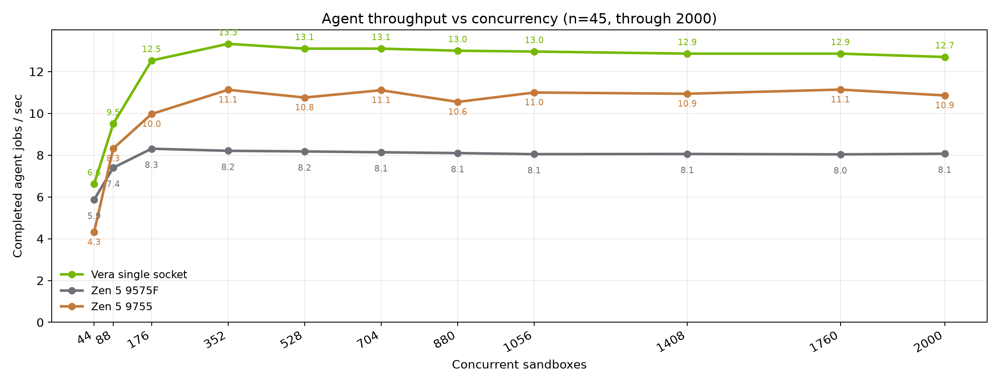
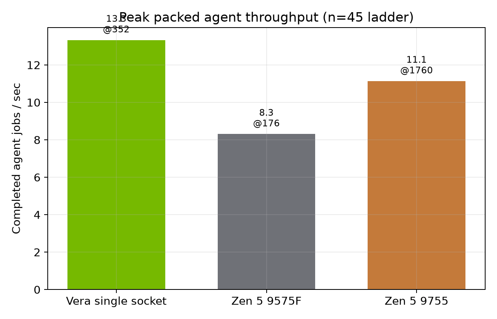
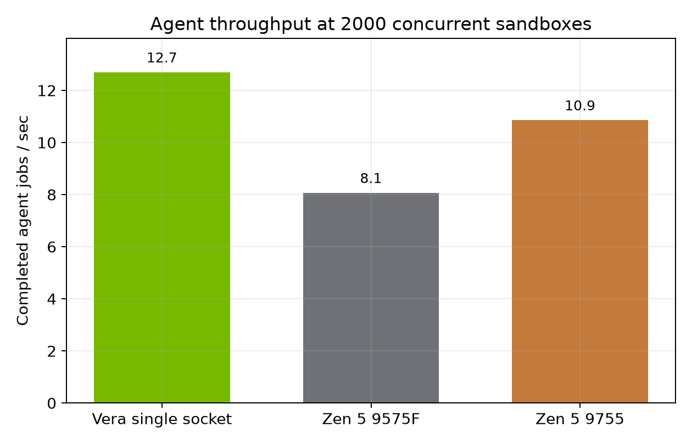
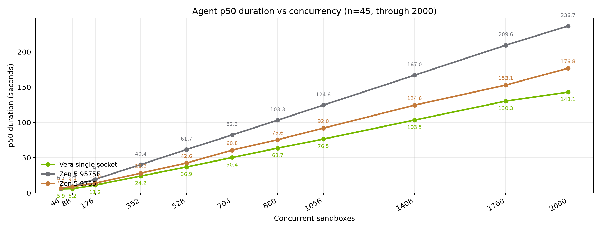
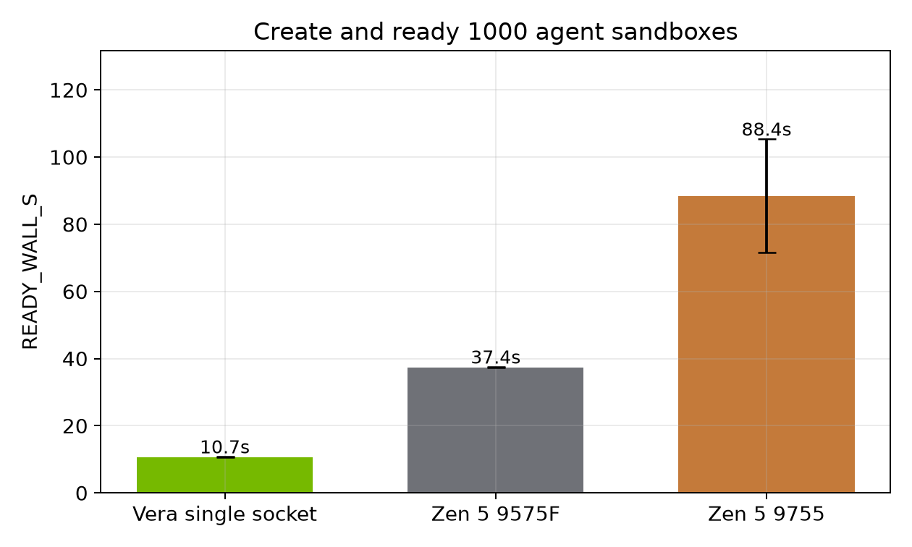
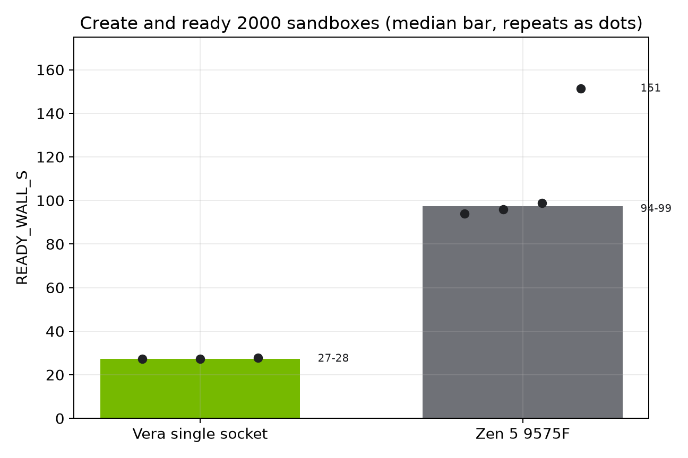

# CPUs for Agentic Sandboxes

October 2026. Daytona.

Daytona runs coding agents inside isolated sandboxes. A production node packs many of those sandboxes on one machine. We measured that packing on one Vera socket, an EPYC 9575F, and an EPYC 9755, from 44 sandboxes through 2000, and we timed cold create-and-ready at 1000 and 2000.

**Packed throughput and cold-start admit rank these chips differently.** More cores lift the packed plateau. Cold start still follows clocks and the boot path. A chip that wins one question can lose the other.

This is the CPU question that remains after the substrate is fixed. We measured the cost of the substrate itself in a companion study of containers, hosted sandboxes, Kubernetes, and cloud VMs (arXiv:2607.01415). The runs below all use the same Daytona sandbox path. The difference left is the chip, and how the machine behaves once it is full.

## The two questions

1. How many agent jobs per second does the chip still deliver when the node is full.
2. How fast can we stand up a dense fleet when we need to.

Single-thread peak is a third number. The headline is the packed plateau, and the cold admit beside it. **The packed plateau is the production number.** Daytona does not run one benchmark process at a time.

## The workload

The job is `repo-agent-v3` at `n=45`. Each sandbox runs eight episodes. An episode seeds a broken Python package, searches it, parses it, applies a patch, and runs pytest. That is the loop agents use on Daytona, with the model call removed so the CPU and the filesystem are what we measure. There is no LLM and no network in the episode.

Successful episodes on all three hosts returned the same checksum (`344faa07…`). Clean waves finished that checksum with zero failures. The hosts did the same work.

## How we measured

Same image, `dtgraviet/vera-agent-benchmark:v3`. Same seed, 42. Fractional CPU `0.025`, with a burst cap of 1, memory guarantee `0.0625` GiB, and a 1 GiB disk. Hold-then-exec: the fleet is created first, and throughput is completed episodes divided by exec wall. Create is a separate measurement.

The client ran on the host.

Vera's host is a two-socket Olympus machine, 352 logical CPUs. Create-and-ready on Vera records a pin to socket 0, cpus `0-87,176-263`, memory node 0, so the compare is one 88-core socket. The dense ladder was collected on that host with the client on the machine, as a one-socket study.

9575F is one socket, 64 cores, 128 threads. The October create-ready host reports AMD EPYC 9575F 64-Core Processor. 9755 is one socket, 128 cores, 256 threads, AMD EPYC 9755 128-Core Processor. 9575F is the high-clock part. 9755 is the high-core part.

We quote waves with zero failures. Three waves in the dense files had failures, and the text names them.

## What a fair run keeps out of the number

A few setup mistakes publish the wrong chip. We hit each of them before these files were the ones worth quoting.

The client has to run on the host. An earlier Vera ladder driven through an SSH tunnel from a laptop flattened jobs per second while the in-guest time barely moved. That plateau was the tunnel.

Throughput is exec time after the fleet is held. A jobs/s figure that includes create is an admit result. Cold start has its own section so the two numbers stay apart.

Create-and-ready uses the snapshot path. With snapshot resume left off, creates pile up, and a 60 second pickup cap fails jobs the machine would have finished. An earlier 9575F attempt at 2000 died that way, three times, all with `no matching capacity`. Those failures are an operations result. The October runs below are the clean ones, 2000 of 2000, snapshot path on.

## Packed throughput

Vera's clean peak is 13.3 jobs/s at 352 sandboxes. From there through 1760 it stays between 12.9 and 13.1, every rung at zero failures. The 2000 rung is 12.7 jobs/s with 53 failures, so 1760 is the last clean Vera point.

9575F peaks at 8.3 jobs/s at 176 and stays near 8.1 through 2000. Every rung is clean, including 2000 at 8.1 jobs/s.

9755 is the slowest of the three at 44 sandboxes, 4.3 jobs/s against 6.6 on Vera and 5.9 on 9575F. It then climbs. On clean rungs it sits near 11 jobs/s from 704 (11.1) through 2000 (10.9). The 352 rung printed 11.1 with 14 failures. The 1760 rung printed 11.1 with one failure. The clean plateau is the number we use.

Once the node is full, the order holds. 9755 closes much of the gap versus 9575F. Vera still leads. At 2000 the line is Vera 12.7, 9755 10.9, 9575F 8.1, with Vera's 53 failures on that rung and the other two clean.

The peak chart marks the highest rung in each file. Vera's mark, 13.3 at 352, is clean. 9575F's mark, 8.3 at 176, is clean. 9755's mark, 11.1 at 1760, is the rung with one failure. Its highest clean rung is 11.1 at 704.

Throughput stays flat while each job gets slower. A flat jobs/s line is the machine filling up, with more sandboxes taking longer, in proportion.

## Duration under pack

Median in-sandbox time climbs on all three. At 44 sandboxes the medians are 5.9 seconds on Vera, 6.7 on 9575F, and 7.2 on 9755. At 2000 they are 143, 177, and 237 seconds.

Vera's 143 second median sits on the rung with 53 failures. The last fully clean high rung is 1760: 130 seconds on Vera, 153 on 9755 (one failure on that 9755 rung), and 210 on 9575F.

The duration ratio tracks the throughput ratio once the node is full. 9575F's median is about 1.6× Vera's, and Vera's throughput is about 1.6× 9575F's. 9755 sits between them on both axes. The plateau is real work getting slower under load.

## Cold start

Create-and-ready times cold admit. It boots the agent image and runs `echo ready` across the whole fleet. The coding loop, pytest included, is the throughput section above.

Vera finishes 1000 sandboxes in 10.7 ± 0.1 seconds, four clean runs, 1000 of 1000.

9575F finishes that path in the low-to-mid thirties. Three September runs on the earlier cell were 31.9, 32.4, and 32.7 seconds. Two October runs were 35.6 and 39.2 seconds. All five were 1000 of 1000.

9755 is slower, and the repeats spread. Four clean runs took 76, 81, 99, and 108 seconds.

The chart below is the series from the earlier three-way share. Vera's bar is the four-run mean. 9755's bar is the mean of three of the four runs, 88 seconds, and the whisker is the spread of those three. 9575F's bar is 37.4 seconds from a three-repeat series that does not name a JSONL file. The files we can open put 9575F in that same band. The order on this check is Vera, then 9575F, then 9755.

At 2000, Vera finishes in 27.4 ± 0.8 seconds, three clean runs, 2000 of 2000. 9575F now has four clean October runs. Three finished between 94 and 99 seconds. One finished in 151 seconds. The chart shows the median as the bar and every repeat as a dot. 9755 has no clean 2000 create in this corpus. The chart is Vera and 9575F.

Read the two sections together. 9755, the 128-core part, passes 9575F on packed agent throughput and loses to it on cold admit. Vera leads both. **Core count lifts the packed plateau. Cold start still follows clocks and the boot path.**

## What a future chip has to do

A good CPU for this work has to clear three bars at once.

1. Fast on one mixed agent burst: Python, search, parse, patch, pytest.
2. A high packed plateau through thousands of fractional sandboxes, with per-job time that degrades smoothly and a failure count that stays at zero.
3. A cold admit that stays tight at 1000 and at 2000.

The 9755 versus 9575F split is the evidence for the second and third bars. Doubling the cores, and giving up clock, moved the plateau from about 8 jobs/s to about 11. The same change made a 1000-sandbox ready path slower and wider. A future part that only grows core count will look like a win on the plateau chart and a regression on the admit chart.

This dataset has no hardware counters. We can see the shape of the curves. The next measurement is which shared resource saturates first. The counters we want on the next chip are memory bandwidth, cache misses, remote memory, and storage queue depth, sampled while a packed agent wave is running. Those would tell us whether the plateau is cores, bandwidth, or the path into the sandbox.

An earlier program, from August, ran media, analytics, filesystem, and a Graviton5 reference on different client paths and different CPU sizes. Zen 5 led media transcode there. Graviton5 stretched per-job time as the node packed. Those ladders are a different experiment. Their jobs/s figures are not on the charts in this report. The tradeoff we still carry is that a part tuned only for the Python and filesystem loop can give away vector and media work, where Zen 5 has been the stronger chip.

## Limitations

The main result is one workload, the agent loop above. Fractional `0.025` CPU is a density stress. It is a different question from a 1-vCPU customer sandbox.

Vera is one socket of a two-socket host. 9575F and 9755 are one-socket parts. The pin is recorded on the Vera create-and-ready files. The dense Vera file records the client on that host and does not repeat the cpuset.

The 9755 dense ladder capped memory at 0.5 GiB. Vera and 9575F allowed 4.0 GiB. 9755 also used a larger client connection pool. We did not rerun the others to match those two knobs. The ranking survived across many rungs. The knob difference is still real.

9755 create-ready at 1000 spreads from 76 to 108 seconds. 9575F create-ready at 2000 has one 151 second run beside three runs at 94 to 99 seconds. We report the spread. A single best run would overstate both chips.

Vera's dense 2000 rung and two 9755 rungs (352 and 1760) contain failures. Checksums on those waves did not all match. Neighboring clean rungs carry the claim.

## Appendix

Every quoted figure comes from the files below. Reprint the summary with:

`uv run python daniel-focus-here/plotting/pin_headline.py`

Dense ladders, `n=45`, hold-then-exec, concurrency 44 through 2000:

`daniel-focus-here/vera-jsonl/vera_graph_source_dense2k_20260906_183636.jsonl`

`daniel-focus-here/zen5-9575f-jsonl/concurrency_20260908_122958_n45.jsonl`

`daniel-focus-here/zen5-9755-jsonl/concurrency_20260923_180424_n45_tuned_cleanest.jsonl`

Create-and-ready, 1000, Vera. Two of the four summaries live in a `.meta.json` sidecar beside an empty JSONL:

`daniel-focus-here/vera-jsonl/vera_create_ready_1000_20260908_121324.jsonl`

`daniel-focus-here/vera-jsonl/vera_create_ready_1000_rep2_20260908_121545.jsonl`

`daniel-focus-here/vera-jsonl/vera_create_ready_1000_clean_20260908_122335.meta.json`

`daniel-focus-here/vera-jsonl/vera_create_ready_1000_clean2_20260908_123044.meta.json`

Create-and-ready, 1000, 9575F, September:

`results/zen5-jsonl/redswitches_create_ready_1000_20260908_202913.jsonl`

`results/zen5-jsonl/redswitches_create_ready_1000_20260908_210003.jsonl`

`results/zen5-jsonl/redswitches_create_ready_1000_20260908_225335.jsonl`

Create-and-ready, 1000, 9575F, October:

`daniel-focus-here/zen5-9575f-jsonl/epyc9575_create_ready_1000_20261002_232050.jsonl`

`daniel-focus-here/zen5-9575f-jsonl/epyc9575_create_ready_1000_20261002_232214.jsonl`

Create-and-ready, 1000, 9755:

`daniel-focus-here/zen5-9755-jsonl/epyc9755_create_ready_1000_20260923_202107.jsonl`

`daniel-focus-here/zen5-9755-jsonl/epyc9755_create_ready_1000_20260923_202758.jsonl`

`daniel-focus-here/zen5-9755-jsonl/epyc9755_create_ready_1000_20260923_203040.jsonl`

`daniel-focus-here/zen5-9755-jsonl/epyc9755_create_ready_1000_20260923_203449.jsonl`

The 1000-sandbox chart's 9575F bar is the unsourced series in `daniel-focus-here/zen5-9575f-jsonl/zen5_graph_ready_1k.jsonl` (37.27, 37.40, 37.53 seconds). The 9755 bar on that chart omits the 99 second run.

Create-and-ready, 2000, Vera:

`daniel-focus-here/vera-jsonl/vera_create_ready_2000_rep1_20260908_133315.jsonl`

`daniel-focus-here/vera-jsonl/vera_create_ready_2000_rep2_20260908_133731.jsonl`

`daniel-focus-here/vera-jsonl/vera_create_ready_2000_clean_20260908_140442.jsonl`

Create-and-ready, 2000, 9575F, October:

`daniel-focus-here/zen5-9575f-jsonl/epyc9575_create_ready_2000_20261002_232612.jsonl`

`daniel-focus-here/zen5-9575f-jsonl/epyc9575_create_ready_2000_20261002_233120.jsonl`

`daniel-focus-here/zen5-9575f-jsonl/epyc9575_create_ready_2000_20261002_233826.jsonl`

`daniel-focus-here/zen5-9575f-jsonl/epyc9575_create_ready_2000_20261002_234110.jsonl`

The earlier failed 9575F 2000 attempts, pickup cap only, are `daniel-focus-here/zen5-9575f-jsonl/zen5_graph_ready_2k.jsonl`.
