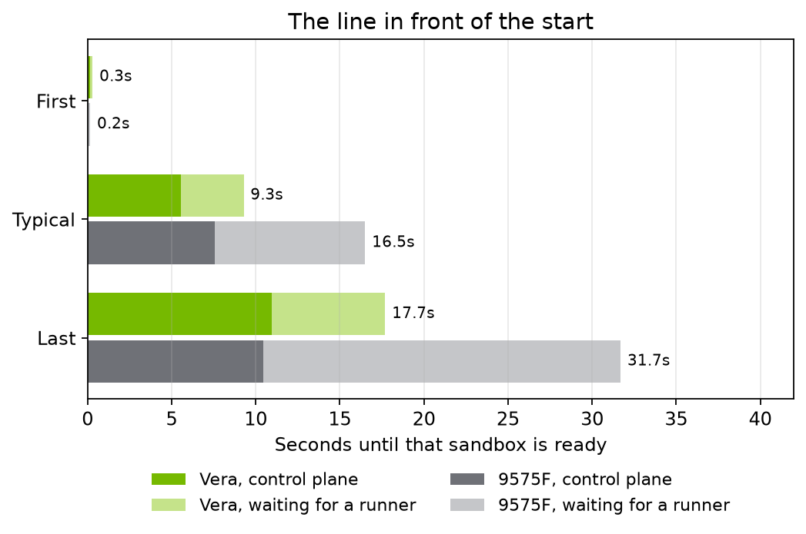
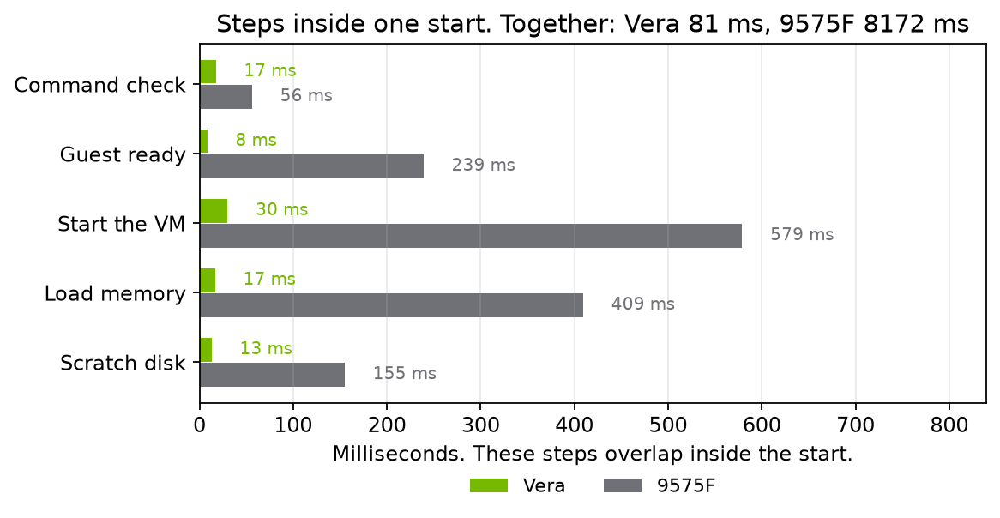

# Where the sandbox start goes, Vera and the 9575F

Same thousand sandboxes, same image, same 16 MiB disk. Three runs on each chip. All 1000 came up, from the snapshot.

Vera's start is about 80 milliseconds. On the 9575F the same start is 7.2, 8.9, and 8.5 seconds. The batch is about 19 seconds on Vera. On the 9575F it is 35.0, 30.6, and 33.4 seconds.

The 9575F is one 64-core socket. The Vera numbers are the OCI box, both sockets.

| | Vera | 9575F run 1 | 9575F run 2 | 9575F run 3 |
| --- | --- | --- | --- | --- |
| First, ready | 0.3 s | 0.2 s | 0.2 s | 0.1 s |
| Typical, control plane | 5.2–5.9 s | 7.8 s | 7.1 s | 7.8 s |
| Typical, waiting for a runner | 3.5–3.9 s | 9.2 s | 8.7 s | 8.9 s |
| Typical, ready | 9.2–9.6 s | 17.8 s | 16.2 s | 16.6 s |
| Last, control plane | 9.0–12.5 s | 4.0 s | 17.8 s | 9.5 s |
| Batch | 18.7–19.1 s | 35.0 s | 30.6 s | 33.4 s |

Vera is faster to be ready. A typical sandbox is ready in about 9 seconds on Vera and about 16 to 18 seconds on the 9575F. The last request's accept overlaps: about 9 to 12 seconds on Vera, and 4.0, 17.8, and 9.5 seconds on the 9575F.

| Step | Vera | 9575F run 1 | 9575F run 2 | 9575F run 3 |
| --- | --- | --- | --- | --- |
| Scratch disk | 13 ms | 156 ms | 166 ms | 143 ms |
| Load memory | 16–17 ms | 425 ms | 426 ms | 377 ms |
| Start the VM | 29–31 ms | 450 ms | 752 ms | 535 ms |
| Guest ready | 8–9 ms | 226 ms | 247 ms | 244 ms |
| Together | 79–83 ms | 7155 ms | 8906 ms | 8456 ms |
| Command check | 17–18 ms | 55 ms | 56 ms | 58 ms |

Scratch, memory, the VM, and guest ready run at the same time. Together they are the start. Vera is faster on every one of those steps. The command check is a few tens of milliseconds on both.
