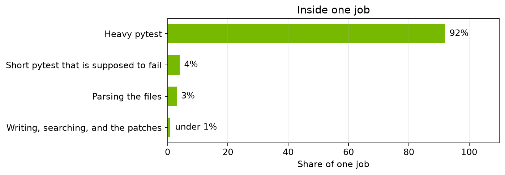
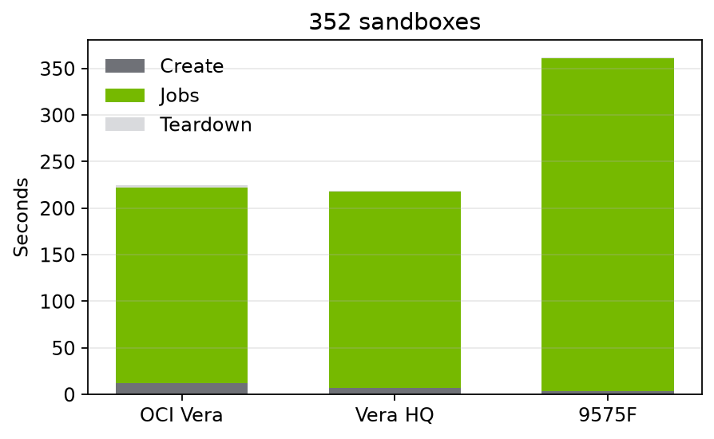
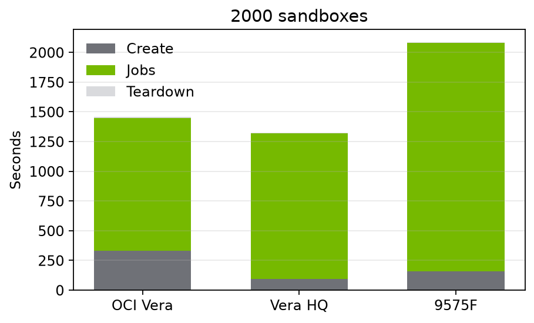

# Technical Details For Agentic Workload Ladder

We ran the same coding workload at increasing levels of concurrency, from 44 to 2,000 sandboxes. The workload writes and searches files, applies code patches, parses files, and runs Python tests with pytest. Most of its execution time is spent running those tests.

We compared one socket of the NVIDIA Vera machine on Oracle Cloud Infrastructure (OCI) with the existing single socket Vera HQ results and an AMD EPYC 9575F. The graphs show both how many workload executions each system completes per second and how long each benchmark batch takes, including sandbox creation and cleanup.

## What happens inside each sandbox?

The timing breakdown below comes from one separately timed execution of the workload. It was measured outside the concurrency benchmark, so it helps explain the workload but does not establish the breakdown at every sandbox count.

The longer pytest run accounts for approximately 92% of execution time. A shorter pytest run that is expected to fail accounts for another 4%. Parsing files takes about 3%, and writing files, searching files, and applying patches together take less than 1%. File operations are part of the workload, but they do not contribute as much to the measured duration.

## How long does the full benchmark batch take?

The next three graphs include sandbox creation, workload execution, and cleanup. The gray section measures creation, the green section measures workload execution, and the pale section at the top measures cleanup. The full height of each bar is the elapsed time for all three phases. Shorter bars mean the batch finishes sooner.

### At 352 sandboxes, workload execution accounts for almost all the elapsed time.

OCI Vera spends 210.2 seconds executing the workload and 224.2 seconds on the full batch. Vera HQ spends 211.3 seconds on execution and 218.4 seconds overall. The 9575F spends 357.3 seconds on execution and 362.1 seconds overall.

The two Vera systems have almost identical execution times here. OCI Vera takes slightly longer overall because difference in sandbox creation time (OCI memory is not the same as the memory used at HQ). The 9575F longer execution phase makes the full batch substantially slower.

### At 1,408 sandboxes, the Vera execution times remain close.

OCI Vera spends 861.8 seconds executing the workload, compared with 876.0 seconds for Vera HQ and 1,361.4 seconds for the 9575F. Including creation and cleanup, the totals are 930.0, 900.4, and 1,457.1 seconds, respectively.

OCI Vera finishes the execution phase slightly sooner than Vera HQ, but takes longer overall due to the sandbox creation phase. Execution still accounts for about 93% of OCI Vera's total batch time.

### At 2,000 sandboxes, OCI Vera's creation time becomes a larger part of the total.

OCI Vera spends 1,117.0 seconds executing the workload, less than Vera HQ's 1,226.5 seconds and the 9575F's 1,923.4 seconds. However, OCI Vera takes 328.8 seconds to create the sandboxes, compared with 94.1 seconds for Vera HQ and 157.5 seconds for the 9575F.

That changes the overall result. OCI Vera has the shortest execution phase, but Vera HQ finishes the full batch sooner. The totals are 1,457.5 seconds for OCI Vera, 1,323.5 seconds for Vera HQ, and 2,086.9 seconds for the 9575F. OCI Vera's creation phase accounts for about 23% of its total elapsed time at this concurrency.

## What do these results tell us?

For this workload, the two Vera systems sustain similar completion rates once several hundred sandboxes are running. Both complete substantially more workload executions per second than the 9575F at high concurrency.

The separately timed execution shows that pytest is the bulk of the workload. These results therefore tell us about running many concurrent Python test workloads and lighter file editing and creation. 

## Detailed measurements

The first table reports completed workload executions per second. The second reports elapsed seconds for each phase of the benchmark batch.

| Sandboxes | OCI Vera | Vera HQ | 9575F |
| --------- | -------- | ------- | ----- |
| 44        | 6.7      | 6.6     | 5.8   |
| 88        | 8.8      | 9.5     | 7.1   |
| 176       | 12.7     | 12.5    | 7.8   |
| 352       | 13.4     | 13.3    | 7.9   |
| 528       | 13.3     | 13.1    | 8.4   |
| 704       | 13.3     | 13.1    | 8.4   |
| 880       | 13.2     | 13.0    | 8.3   |
| 1056      | 13.1     | 13.0    | 8.4   |
| 1408      | 13.1     | 12.9    | 8.3   |
| 1760      | 13.2     | 12.9    | 8.3   |
| 2000      | 13.3     | 12.7    | 8.3   |

| Sandboxes | OCI Vera create | OCI Vera jobs | OCI Vera teardown | Vera HQ create | Vera HQ jobs | Vera HQ teardown | 9575F create | 9575F jobs | 9575F teardown |
| --------- | --------------- | ------------- | ----------------- | -------------- | ------------ | ---------------- | ------------ | ---------- | -------------- |
| 44        | 0.7 s           | 52.6 s        | 0.3 s             | 7.3 s          | 53.1 s       | 0.1 s            | 0.8 s        | 60.4 s     | 0.1 s          |
| 352       | 11.6 s          | 210.2 s       | 2.4 s             | 6.6 s          | 211.3 s      | 0.5 s            | 3.7 s        | 357.3 s    | 1.1 s          |
| 1408      | 59.3 s          | 861.8 s       | 8.9 s             | 22.2 s         | 876.0 s      | 2.2 s            | 91.7 s       | 1361.4 s   | 4.0 s          |
| 2000      | 328.8 s         | 1117.0 s      | 11.7 s            | 94.1 s         | 1226.5 s     | 2.9 s            | 157.5 s      | 1923.4 s   | 6.0 s          |

